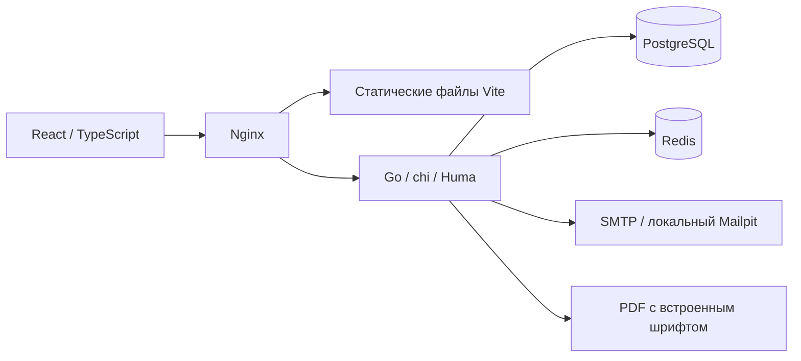
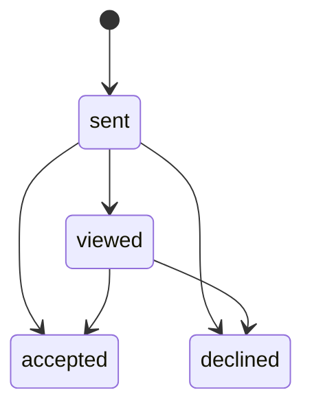

# Архитектура и правила продукта

## Текущий объём

Веб-приложение реализует обязательную механику обратного найма: кандидат
регистрируется, подтверждает почту, заполняет профиль, выбирает специализацию
и предполагаемый уровень, проходит тест. Работодатель описывает потребность,
находит категорию и направляет предложение конкретному человеку с зарплатой.
Кандидат принимает или отклоняет предложение.

Отрасль MVP фиксирована: ИТ. Специализации: backend, frontend, analytics.
Грейды: junior, middle, senior. Возраст, география и стаж не присваивают грейд.

## Компоненты



Backend — модульный монолит. HTTP-слой описывается через Huma;
бизнес-сценарии находятся в internal/app, чистые расчёты — в assessment
и matching. Пользовательские запросы sqlc типизированы; остальные запросы
выполняются pgx с параметрами. Миграции goose встроены в бинарный файл.

PostgreSQL является источником истины для аккаунтов, согласия обработки,
профилей, тестов и ответов, подтверждённых категорий, истории грейда,
достижений, компаний, приглашений, токенов почты и очереди писем.
Redis хранит сессии и счётчики ограничения частоты запросов.

## Авторизация и видимость

Регистрация выполняется по email с подтверждением одноразовой ссылкой.
Пароли хешируются bcrypt. В БД хранится digest одноразового токена;
оригинал присутствует в очереди письма до успешной отправки, после чего
текст письма очищается. Ссылки подтверждения действуют 24 часа,
восстановления — 30 минут. Сессия живёт 7 дней.

Cookie сессии HttpOnly, SameSite=Lax, Secure при HTTPS. Изменяющие запросы
требуют X-Requested-With: fsp и проходят проверку Origin. Запросы
авторизованных действий дополнительно требуют X-CSRF-Token текущей сессии.
Публичные операции входа и восстановления не требуют старого CSRF-токена.
API не включает разрешающий cross-origin CORS.

Смена пароля увеличивает auth_version: ранее созданные сессии теряют доступ.
Недоступность Redis не открывает защищённые данные.

Кандидат видит свой профиль, попытки и приглашения. Работодатель получает
только опубликованные профили с подтверждённой категорией, за исключением
профиля кандидата, ранее принявшего его приглашение. Email исключён из
поиска и детального профиля до принятия приглашения этой компании.
Проверка выполняется на сервере, а не только в интерфейсе.

Согласие на обработку аккаунта фиксируется при регистрации. Публикация
включается отдельным действием в профиле. Полный комплект организационных
документов обработки персональных данных не входит в текущий стенд.

## Тестирование

Тест имеет план из 6 тем для комбинации специализации и грейда. В версии
2026.10-v3 три задания проверяют концепции с альтернативными практическими кейсами, ещё три требуют ответа по
сгенерированным численным условиям. Порядок вариантов ответа перемешивается.
Параметры находятся в ограниченных диапазонах; операции внутри семейства
заданий фиксированы. Вариант и версия шаблонов сохраняются в PostgreSQL.

Время — 20 минут. Каждое задание имеет одинаковый вес; порог — 70%, то есть
нужно минимум 5 правильных ответов из 6. Числовые ответы поддерживают
десятичную точку и запятую; сравнение допускает погрешность менее 0,005.
Ключ ответов остаётся на сервере и не попадает в OpenAPI либо ответ кандидату.

Повтор того же сочетания специализации и грейда разрешается через 24 часа.
Одновременно активна одна попытка. Срок окончания проверяется по сохранённому
deadline; удаление данных Redis не обнуляет таймер.

Первый провал сохраняет неподтверждённый статус, такой профиль не попадает
в поиск. Успех устанавливает категорию. После успеха новая смена категории
доступна через 90 дней. Неудача не понижает прежний подтверждённый грейд.
Эта версия допускает одну подтверждённую категорию на кандидата.

Описание потребности работодателя выделяет специализацию и грейд, по ним
формируется образец теста. Навыки из описания используются в подборе;
оценка конкретного стека внутри категории требует дальнейшего расширения банка.

Устойчивость к копированию готового ключа проверена синтетическим экспериментом.
Она не заменяет защиту от посторонней помощи и экспертную калибровку сложности.
Результаты и границы выводов описаны в validation.md.

## Поиск и ранжирование

Фильтрация категории использует только результаты теста. Простой разбор
описания потребности понимает основные названия специализаций, грейдов
и навыков. Если направление не распознано, работодатель может выбрать
его явно в фильтре. Отдельно заданный стек — строгий фильтр; стек,
извлечённый из описания, влияет на ранжирование.

При заданном стеке оценка:

```text
score = floor(test_score * 0.5)
      + floor(matched_unique_skills / requested_unique_skills * 40)
      + floor(min(achievement_count, 3) / 3 * 10)
```

Без заданного стека учитываются тест и ФСП; оценка нормализуется на 100.
Одинаковые оценки разрешаются стабильной сортировкой по ID.
Итоговый балл является эвристикой соответствия, а не вероятностью найма.
Каждая карточка объясняет вклад теста, совпадения стека и достижений.
Самоописанные навыки обозначаются отдельно от подтверждённой категории.

Фильтры и запрос сохраняются в URL. При уточнении отображается предыдущая
подборка до получения новой. Возврат из открытого профиля сохраняет запрос.
Результат выдаётся страницами по 20 записей. Текущий MVP рассчитывает
ранжирование опубликованных профилей в памяти API; большой банк потребует
переноса предварительного отбора и пагинации в SQL.

## Приглашения

Зарплата обязательна: диапазон рублей в месяц до вычета налогов.
Приглашение содержит компанию, описание предложения и email работодателя;
публикация вакансии не требуется.



Решение кандидата финальное. Повтор того же решения идемпотентен.
Обратные переходы между accepted и declined запрещены. Пока предыдущий
контакт ожидает решения, повторное приглашение той же компании запрещено.
Статусы видны обеим сторонам по их собственным записям.

## Короткие задания и актуальность профиля

Работодатель публикует небольшую задачу для одной специализации и грейда.
Задание автоматически появляется у кандидатов подтверждённой категории и
принимает решения 7 дней. Ожидаемое время — 5–30 минут. Кандидат может
отправить одно решение в 7 дней; блокировка строки профиля защищает это
ограничение и при одновременной отправке разных заданий.

Автор задачи видит решения и оставляет обязательный комментарий с оценкой
«подход подходит» или «есть что улучшить». Другие работодатели и кандидаты
не видят чужих решений. Решение не открывает контакты кандидата.

После положительной проверки в профиле сохраняется дата выполнения задачи,
если её категория совпадает с текущей подтверждённой категорией кандидата.
Отложенная проверка не делает старое решение свежим; используется дата
отправки, а не проверки. Грейд, балл теста и интервал его смены не меняются.
При равном итоговом рейтинге преимущество получает более свежая практика
за последние 30 дней. В выдаче это объясняется отдельно от тестового балла.
История решений и обратная связь остаются доступны после закрытия задачи.

## ФСП и дальнейшие интеграции

API ФСП не предоставлен. В демонстрационном режиме доступны DEMO-1001
и DEMO-1002; они добавляют явно помеченные синтетические достижения.
Без DEMO_SEED привязка тестового ID отключена. Для кандидата без истории
доступны тестирование, поиск и приглашения.

Будущий адаптер реестра должен получать subject участника из проверенного
OIDC-входа или подтверждённого процесса связывания аккаунтов. Он хранит
идентификатор события, дисциплину, дату, место, роль в команде и источник
верификации. Обновления выполняются идемпотентно, с отдельным учётом свежести.
Совместимость с Keycloak реализуется через OIDC; локальный аккаунт и
внешняя идентичность связываются после проверки владения обеими сторонами.
Самостоятельно вписанный ФСП ID не должен считаться реальной верификацией.

LLM можно подключить через отдельный интерфейс для извлечения требований
и подготовки кандидатов в банк заданий. Сгенерированные задания проходят
валидацию и попадают в версионированный банк; окончательные оценки кандидатов
используют проверяемые критерии. В текущем MVP LLM не подключена.

ATS: версионированный REST API, webhooks изменений приглашения с подписью,
idempotency key, delivery log и повторной доставкой. Контакт передаётся
только после согласия кандидата. Для автоматических событий подходит outbox.

Защита от недобросовестных работодателей: подтверждение домена компании,
проверка организации, ограничения рассылки, жалобы и история решений
модерации. Сейчас есть ограничение отправки приглашений, полноценной
верификации компаний и модерации нет.

## Необязательные возможности следующей версии

Работа нескольких рекрутеров в одной компании, расширенная оценка конкретного стека, загрузка
PDF-резюме с распознаванием и интеграция с реальным реестром.

## Вакансии, отклики и рабочее пространство

Вакансия проходит состояния draft, published, closed. Создание сохраняет
черновик; публикация выполняется отдельно. Зарплата обязательна, офис и
гибрид требуют города. Редактировать и закрывать вакансию может только автор.

Кандидат с подтверждённой категорией может откликнуться с отдельным согласием
на передачу профиля и почты этой компании. Публикация профиля для этого не нужна.
Статусы отклика: new, viewed, shortlisted, rejected, withdrawn. Компания видит
только отклики на собственные вакансии. Кандидат может отозвать отклик.
Отзыв прекращает доступ к контактам по этому основанию, сохраняя отдельно
принятые приглашения и активные отклики на другие вакансии той же компании.

Избранное принадлежит конкретному работодателю. Снятие публикации скрывает
профиль из списка, если нет отдельного согласия на контакт. Сравнение получает
до трёх профилей через тот же API с теми же проверками доступа. Вклад факторов
складывается точно в индекс подбора; индекс не является вероятностью найма.

Паспорт квалификации выводит основания по темам последней успешной попытки
текущей категории, её дату и версию. Варианты заданий и ответы не раскрываются.
Синтетические баллы seed-профилей отдельно обозначаются как demo, а импорт
без попытки как imported. Оценка резюме не превращается в подтверждение навыков.

Обзор использует агрегаты собственных приглашений и откликов. Категории банка
кандидатов доступны работодателю и учитывают только опубликованные,
верифицированные профили с присвоенным грейдом.
